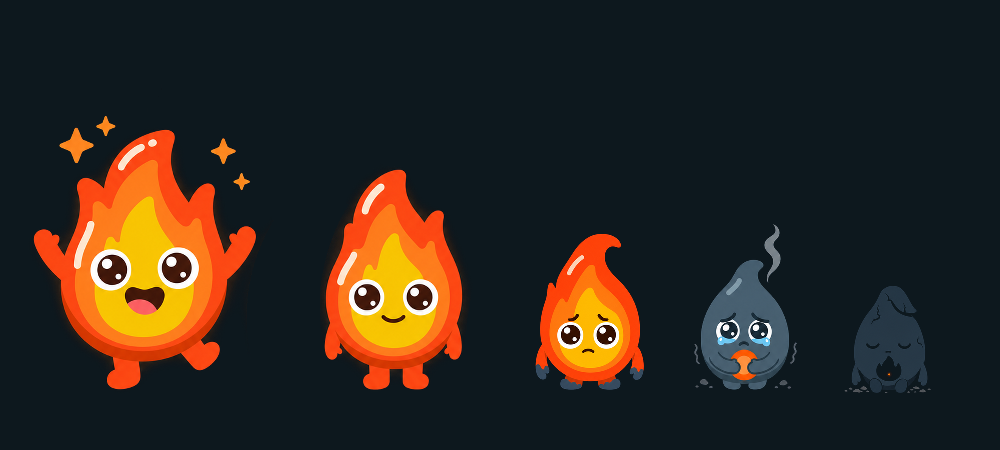

# Mo

Mo is Momentum's pet: a small living flame whose body is the user's momentum. He burns when routines are kept and goes out when they are not. He never dies, and one completed action always warms him. His job is honest guilt, and he never lies about the data. Neglect hurts him; a task that is merely late today makes him angry, which is a different and much funnier thing.

`pet/mo-reference.png` is the approved reference, left to right: Blazing, Steady, Dimming, Cold, Husk. When this text and the image disagree, the image wins and this text gets fixed.

## Always true

These hold in every state, pose, size, and medium. A rendering that breaks one of them is not Mo.

- **He is a flame, not an egg with hair.** One body with a wide, chubby, rounded base whose sides sweep up into a single fat tip that leans to the viewer's right, with one smaller fat tongue on each shoulder. Nothing floats above his tip: no detached flame, spark, or flamelet. An act may let a flame leave him for a moment, such as a hiccup that pops one off his tip and fades it out, but that is a gag in the act, never part of him. Every tip is blunt and rounded like a bubble letter, never thin or spiky. The face sits directly on the body. No head, no neck.
- **Three nested flames.** The body is three flat shapes, each flame-shaped, like the layers of a candle flame: the outer flame, a middle flame inside it, and a belly flame low in the body that holds the face. The belly is always the brightest part.
- **Pop rendering.** Solid, saturated, flat colour with hard clean edges. No gradients, no texture, no outline or contour line around any shape. A darker ledge band runs along the very bottom of the body, like the ledge under a Momentum button, and one light gloss mark sits on the upper left of the outer flame. He is made from the same kit as the buttons.
- **Eyes.** Two very large round eyes set wide apart in the belly flame. White sclera, dark-brown iris filling most of the eye, one large white highlight at the upper left and one small one at the lower right. No eyelashes, no eyelids.
- **Mouth.** Small, centred below the eyes. Nothing else on the face: no nose, no ears, no blush marks. Teeth are not drawn in his resting design; an activity may show them as one plain white band.
- **Limbs.** Two stubby mitten arms at the widest part of the body and two short rounded feet. No fingers, toes or knees. An arm bends, but no elbow joint is drawn. Limbs take the colour of the outer flame.
- **Light.** At most a faint warm halo in the two warm states. Nothing else in the app glows, which marks him as the one living thing.
- **He never works against the reason someone opened the app.** People install Momentum to change something, and Mo must not make the opposite look good. Food is the plainest case: someone who wants to eat better should not be shown a doughnut to crave by the app that is meant to help, so what he eats, craves, dreams of, or is rewarded with is food worth wanting, and junk food is never the prize. The scale is the same: weighing in is something he forgets or puts off, never something to fear, because fear of the number is a real problem for people who track their weight. Skipping a task may be funny, even cosy, for a while; the anger that follows a late task is what keeps that honest.
- **Taste, not purity.** Nice things are fine: a mug of cocoa in the cold, a cookie at Christmas, a toast to a good week. He is never preachy. Momentum is meant to grow beyond one person, and a prop that is harmless for one user can hurt another, such as champagne for someone recovering from alcohol. So a prop that touches a risk reads as its harmless version, or at least can be read either way: a celebratory glass is sparkling and orange like juice, not plainly champagne. Alcohol, smoking, and other drugs never appear as fun or as a reward. Avoid obvious misalignment; do not hunt for hidden ones.
- **He is ethically vegan.** He never fishes or hunts, and he would never hurt an animal. Food he eats, grills, or dreams about may be anything that could be vegan, such as a burger, a sausage, or cheese: the grill is tofu. Only food that can only come from an animal is out, such as a drumstick, a fish, or a fried egg.
- **Guilt, not contempt.** Think of the Duolingo owl: he may be smug when a task is late, sarcastic about one left open, dramatic, and furious, because guilt is his job. All of it points at the undone task, never at the user. He never makes fun of their body, weight, looks, or ability, never of what they logged, and never of who they are. No text on or around him.

Reference colours, sampled from the approved image. They are the starting point for Mo's own theme tokens, not literals for product code. His orange sits close to Eating and his yellow close to Reading, but his tokens are never borrowed from a feature, and he is never placed on a solid Eating-coloured surface.

| Part | Colour |
|---|---|
| Outer flame and limbs | `#FD4711` |
| Middle flame | `#FE7C1C` |
| Belly flame | `#F7C401` |
| Ledge band | `#D43901` |
| Gloss mark | `#FEE7D3` |
| Iris and mouth | `#421709` |
| Tongue | `#FB6163` |
| Cold slate: body, gloss, ledge and extremities | `#4A6271`, `#809BAA`, `#384C60` |
| Cold core | `#FE913D` |
| Husk slate | `#263746` |
| Tear | `#64C3F1` |

The background is always the theme's background token; the hollow in the Husk is that same colour, so it reads as a real hole.

## States

Flames do not turn brown when they run low. They get small and low, and then they go out. So Mo keeps his full colours for as long as he burns, and one rule drives the whole sequence: **the cold rises through him from the ground up until only the core is left, and then the core goes out too.**

Size is part of the state. Heights are of the body, relative to Blazing, and are exact.

| State | Height | Body | Tip | Face and pose | Around him |
|---|---|---|---|---|---|
| Blazing | 1.00 | Full colours | Tall | Open smile with tongue, arms thrown up, one foot kicked out | Faint halo, a few chunky four-point sparkles |
| Steady | 0.85 | Full colours | Upright | Small closed smile, arms resting at his sides, both feet down | Faint halo, nothing else |
| Dimming | 0.60 | Same full colours, thinner outer flame. Feet, ledge band, and hand tips have turned slate | Short, bent over to the right | Short eyebrows raised at the inner ends, tiny frown, eyes looking up at the viewer, arms hanging | Nothing |
| Cold | 0.50 | All slate, a slumped droplet. His fire is now a small round core in his belly | Flopped over | Same eyebrows, blue-grey teary eyes looking up at the viewer, one tear on each cheek, both arms hugging the core | Thin smoke wisp, shiver marks, a few ash flecks |
| Husk | 0.40 | Darker slate, sunken, two or three crack lines. Where the core was there is an empty flame-shaped hollow with a single pinpoint spark in it | Collapsed flat against the body | Eyes closed as two downward curves, no eyebrows, no tears, tiny flat mouth, arms limp, sitting | A small pile of ash. No smoke: smoke means he went out a moment ago, and the Husk went out long ago |

Eyebrows exist only in Dimming and Cold. Dimming is the state that does the work, because he still looks savable. In Cold he pleads; in the Husk he has stopped looking at you. The pinpoint spark is what makes the Husk dormant rather than dead, and it is the promise that he can always be rekindled.

## Props and activity wear

Mo himself is bare: nothing is part of him except what is listed above. For an activity he may pick things up or put things on, such as a toothbrush with foam, a book, a dumbbell, a sweatband, or running shoes. These belong to the scene, not to the character, so they follow three rules.

- They come off. Outside the activity he is bare again, and no item ever becomes his permanent look.
- They never hide what makes him readable: both eyes, the mouth, the flame tip, and the flame silhouette stay visible. No hats.
- They are drawn in his style, flat and without outlines, and they do not burn. He is warm, not dangerous.

In every state he may hold or wear something, even something cheerful, such as a bauble at Christmas while he dims: the contrast can be the joke, lovely tree, and the task is still open. His face and body still say how he is. The object he is missing may lie near him, unused.

## Symptoms

Heat says how bad things are overall; symptoms say what was forgotten. A task Missed (never merely Free) on two or three of the last seven days is mildly neglected, on four or five severely, on six or seven direly. Symptoms sit on top of whatever state he is in, and a freeze never hides one.

- **Care shows in his mouth, and it gets worse.** Mild: a wince full of teeth, some stained. Severe: rot, a gap, and the lost tooth at his feet. Dire: a few crooked stumps, two lost teeth, and a green smell rising from his mouth. The teeth are clipped by the mouth, so they grow out of his lips rather than sitting on his face.
- **Everything else lies beside him, unused.** A closed book for Reading, a dumbbell for Activity, a tipped-over pill bottle for Supplements, an empty bowl for Eating, a scale for Weight. They are drawn in slate, the colour of things gone cold, and from severe neglect on a cobweb fans out from them.
- **Only the two most neglected things show**, one on each side, so a bad week never turns him into clutter. The Husk shows none: he is past caring.
- **He only complains about what is still open today.** Nobody wants to hear about dusty weights right after a workout.

## Anger

Every reminder time is the moment a task is asked for. An hour after that, if the task is still open, the task is overdue, and a Mo who still burns is angry about it. A free day that would cover it changes nothing here: it keeps the streak, the heat and the tokens whole, but a task he asked for is just as late. What he does not ask for cannot be late, such as a rest day of Activity's plan that a free day covers (see Tasks), or anything a person said ahead (see Said ahead). The hour is there because several tasks are often done together in one go, and he should not fume at the first while the rest are on their way. His look and his nudges read the same hour (`domain/mo/MoOverdue.kt`), so he never fumes in a notification while Home shows him calm. Anger is his fire turned up, so only Blazing, Steady, and Dimming can be angry; a Cold Mo or a Husk has no fire left for it and stays sad.

- **The look.** The three nested flames go from orange to red, the flame shoots up and flickers fast, tongues of fire spit off the tip. His eyes are cut into a glare by lids that drop toward the middle of his face, under heavy slanted brows; his pupils shrink. He grits a full row of teeth, or shows his bad ones if Care is neglected, shakes both fists, trembles all over, and wears the four little arcs that mean fuming in every cartoon.
- **It is a tantrum, not a threat.** It is about the task, never about the user and never about a logged value. For Substances the task is the check-in: he is cross that the day was not logged, never about what was. It ends the moment the task is done, and he goes straight back to who he was.
- **Where it shows.** On Home and in the widget while something is overdue, and in his nudges through the day, which name the clock and the tasks: it is already six, and these are still open. While anything is overdue his scene is a tantrum and nothing else, in every part of the day: only Husk, Cold, Frozen, bed, and the fear of a streak dying tonight come first. Saving one task while another is still overdue keeps him angry.

## Degrees, and the rare takeover

Mo does not live at the extremes. Most of his life is small: a raised brow, a tapping foot, a pleased hum. Every feeling has three intensities, and the records and the clock decide which one applies, so he starts small and escalates only when there is reason to.

- **Unhappy, in steps.** A task plays no part in what he does until a quarter of an hour after its reminder asked for it, so a reminder gets a moment to be answered. Then it makes him mildly off, a little hungry or a little dim, and the longer it waits the more he makes of it: plainly after two hours, all the way after five. Anger ends that: once a task is overdue he no longer acts it out, and he is angry instead. Once angry he is impatient until two hours past the reminder, then annoyed, and the red tantrum only comes with three overdue tasks, five hours of lateness, or a task he has been let down on all week. Neglect raises the ordinary need acts the same way.
- **Happy, in steps.** An ordinary finished day gets a pleased Mo; a day with a task he asked for still open is not one, even when a free day covers it. A week-long streak or a task kept without a gap makes him excited. A round streak makes him ecstatic.
- **The takeover.** A few moments are worth stopping the app for: the streak reaching a round number, a perfect Monday-to-Sunday week, a comeback the day after a miss or a freeze, a task reaching everything its week expects, everything done before ten. Then he leaves his corner for the stage a level stands on: a warm glow over all of Home, rays behind him as he leaps, what he earned landing at his side, a small line naming the moment and one big line saying what happened. It plays once, at the moment it is achieved, waits for Continue, and never moves anything under it. It means something because ordinary days do not get it.

## Bedtime

He goes to bed so that the user does (`domain/reminder/Bedtime.kt`): at the bedtime set on Settings' Sleep page, or else eight hours before the wake time, and before it one hour to get ready for bed. He sleeps until the wake time. The wake time is the phone's next alarm when it rings within a day and within four hours of the fallback alarm time, so a nap alarm never sends him to bed; otherwise it is the fallback alarm time. With an alarm at 08:00 and no fixed bedtime the wind-down starts at 23:00 and he is asleep by midnight.

- The evening Care reminder asks fifteen minutes before sleep: 23:45 for an 08:00 wake alarm, after forty-five minutes of wind-down. A wake time late enough to push it past midnight, or a bedtime after midnight, keeps it at 23:45 of its own evening. It is a bedtime cue, with no automatic late-night repeat; logging at 03:00 still belongs to that habit day.
- During the wind-down he is Sleepy on his feet: a yawn first, half asleep in the last half hour. Anything overdue, or asked for and still missing, comes first in that hour, because it can still be done.
- Past the hour to be asleep he is in bed until the wake time, whatever is still open: sleep matters more than a late task. The one exception is a streak that dies tonight with no freeze to save it: he stays up, scared, and goes to bed the moment it is saved.
- Husk, Cold and Frozen never go to bed. They have no warmth to tuck in.

## The good side

Guilt alone makes people look away, so doing well has to show as clearly as slipping.

- **Thriving.** A task kept on every due day of the last week, with at least three due days, shows as something good while he burns: strong flexed arms and a sweatband for Activity, round glasses for Reading, a wide white smile with a glint for Care.
- **Busy.** After a save, a burning Mo acts out the task for about nine seconds. He brushes, reads, eats, takes a tablet, weighs himself, or runs. For a task without a motif he gives a little cheer. A sore mouth keeps him from brushing for show. Cold and Husk act nothing out, and neither does a Mo in a tantrum or in the ice: their day goes on as it was. Which act plays moves on with the day. On Home, with animations on, every save is also met with a little hop, or for a workout a burst of fire, whatever state he is in. While he acts the save out only he leaves the floor, and what stands around him stays; otherwise his whole picture hops as one.
- **Frozen.** The day after a freeze paid for a miss, he sits in a block of ice, and inside it nothing moves but a glint across the ice. The first record of the day thaws him. It is the streak's one visible cost. The ice shows on every body, the Husk's too, and it comes before whatever else the day would have him do: what plays is always an act written around the block. A sick day shows no ice, as it asks for no thaw.
- **Grounded.** He always stands on a soft shadow, so he is somewhere and not pasted on.

## In the app

Mo has no store. `moMood` in `domain/mo` derives everything from the records the features already keep, so he cannot disagree with the data and needs no backup work. One ledger answers "was this task due and kept on this day" for heat, streak, and neglect alike, using the same predicates Home uses for its badges.

**Habit day.** A day runs from 04:00 local time until the next 04:00. Logging after midnight but before 04:00 belongs to the preceding date; saved historical date keys are not moved. Streaks and the widget use that same date.

**Tasks.** One task per view per day, for every view Mo watches. The rule is one line under "Counts toward the streak" on each view's settings: Mo asks for what counts toward the streak. He watches a view on the days the reward walk judges it (`watchedBy` in `domain/mo/MoLedger.kt`), from the day it joined and not before, and stops when it leaves. The views Momentum began with, Reading, Care, Supplements, Eating, Weight and Activity, carry a stored flag from before this rule and stay watched outside the streak too; nothing sets that flag for another view. Substances is a task once it counts toward the streak: its task is the check-in, and under either goal what was logged is never judged, so logging honestly never feels risky. He cheers for a completed Plain task. Each feature defines what keeps its task: Weight asks for a measurement regardless of its value, Eating for a reflection regardless of its food-quality rating, Reading for recorded minutes toward its target, Activity for recorded active days, and Care and Supplements for completion of their required actions. Saving a record does not necessarily complete a task. A hidden feature is not due. A feature only becomes due from its own first record, so a feature added later does not wreck the history, and Mo asks nothing of someone who has not started. Eating is always about yesterday: the reflection written today is what keeps today's task. Activity is asked for on the days its week plans, at the workout reminder, or at the check-in time while that reminder is off. Once the week's days are done, or on a day the plan rests, an open day a free day covers asks nothing. A rest day no free day is left for is asked for at the check-in time, because the streak depends on it. Care requires all four slots: brushing and hair foam in both morning and evening sessions. A partial record remains factual logged activity, but does not complete the day. Morning and evening care are two parts, the two checkmarks on Home: each is asked for by its own reminder, becomes overdue on its own, and counts on its own when Mo picks what to do, so a done morning leaves him fresh until the evening reminder. Corrected completion is evaluated across saved history, so historical streak results can change without rewriting records.

**Free days.** A week runs Monday to Sunday, and the rules say what the user actually intends rather than a calendar: Activity is any five active days a week, so it has two free days; Reading and Eating have one each; Care and Supplements have none. A measurement, Weight among them, has no week: it is asked for every day, and its bank earns a token for every so many kept days wherever in a week they fall, as a checklist's does. Weight as it was first stored earned by the week, a token for a week with six logged days, and keeps that until its numbers are saved on its page; from that day it earns by kept days, and no earlier day is judged again. An active day is a gym session with at least one set, or bouldering, running, jogging, or cycling. Free days are dealt in order through the week, so every finished day a task is Kept, Free, or Missed, and everything else reads those three words. A Free day is as good as a Kept one for the streak and for Mo's heat, and it is never neglect. Backfilling a record hands the free day on to the next gap. What the user sees is never the free days but the plan: every feature view carries its week in the header that never scrolls away, as days done out of days expected, such as 3/5 for Activity and 7/7 for Care, and the streak explainer shows the same numbers for all tasks. A count may pass its target, because a sixth active day is simply true. Each feature's calendar marks its free days with a hollow ring; for Eating the ring sits on the day the skipped reflection would have been about.

**Heat.** It runs from 0 to 10. A finished day moves it by +2, +1, -1, or -2 depending on how much of that day was kept or free, which gives one missed day of grace from full heat and a Husk after five. Today can only warm him, and only through real records. While he is Dimming or colder, its first record lifts him at least one state at once, so acting always brings visible relief; a Mo who already burns earns Blazing only with a full day.

**Streak and freezes.** A day with nothing Missed adds one to the streak. A day with anything Missed costs exactly one freeze, however much was missed: a freeze pays for a bad day, a sick day, a day away. Without a freeze the streak restarts. A frozen day keeps the streak but does not grow it. Everything about the streak is the same week, Monday to Sunday, that the free days use: a freeze is earned when a week closes with all seven days perfect, so it appears on Monday, and only the bank grows with the streak, from 3 to 5 at thirty days and 7 at a hundred, enough for a week away. Free days absorb ordinary forgetfulness, so freezes stay what they should be, a reserve. They are spent automatically, which is what lets the bank be derived instead of stored. An untouched morning is never a perfect day yet; today counts early only once everything due has its record. A freeze protects the number only: Mo still cools and still shows the symptom.

**Said ahead.** Wherever a view shows its tokens or its rest days, a person can say now what the close would do anyway, and take it back. Saying it stops the asking: Mo, Home's due times and the view's own reminder leave it alone, and its Home row is settled. It never creates or changes a record, and the reward walk does not read it, so the day's mark, the tokens spent and the streak are what they would have been (`MoEvaluation.moodWith` in `domain/mo/MoMood.kt`, with the rules beside it in `MoChoices.kt`). A choice the facts no longer bear counts for nothing: the record was made after all, or the tokens no longer cover. There are four kinds. A task open today is set aside from its header or from the streak view while its tokens cover all it leaves open; this holds for the day; for Substances the token covers today's judgment of yesterday's record. A checklist with several checkpoints takes its tokens one checkpoint at a time. Its header shows no tokens: the token and the number left stand beside each checkpoint's name, also while the bank is empty, and that token is the switch where one can be set aside. Each holds one token, the checkpoint is no longer asked for, and the checklist is covered once every checkpoint it still owes has one. A task judged by its week's amount, such as Reading, is set aside on any day while the tokens cover what the week still lacks, and that holds until the week ends. Activity on a planned day a rest day covers can be told to rest today: the rest days in its header are the switch, it spends nothing, because the walk deals that rest day anyway, and the workout reminder stays silent. The choices are stored as `PassChoices` (`persistence/PreferencesPassChoiceRepository.kt`): whole tasks and checkpoints for one day, weeks by their Monday.

**One drawing.** `drawMo` in `feature/mo/MoFigure.kt` is the only implementation of his looks. It is a pure function of his look and of time, traced from the approved reference, and all motion is drawn, never laid out. `Mo` runs it every frame for idle motion that never ends: the flame sways from its base, he breathes and blinks, tears well up, smoke rises, and in the Husk only the spark pulses. With system animations off he holds his resting pose. `MoHeader` is the top of Home: the streak and the freezes as two pressable score chips, then Mo as large as the screen allows. Pressing a chip opens a picture of how the streak works, all of it one Monday-to-Sunday week: the seven days under their initials, this week's days done out of days expected for every task, three rules of a few words each, and how the bank grows. On the launchpad a task tile shows an empty socket until its reward coin lands in it, dimmed while a free day would still cover it; a task whose day has several parts, such as Care's morning and evening, shows a ring of that many segments that turn gold one by one, and the coin only lands when all are done, so a tile with neither is plainly not part of the streak: Statistics and Settings never are, and Substances only while it counts toward it. Home itself never scrolls; the launchpad is a three-by-three grid that sizes its tiles to the height he leaves. He says nothing on Home.

**Moments.** What he is doing is a passing moment, not part of his mood. Coming back to Home after a save, he acts out what was just logged for a few seconds, and a saved workout makes him burst into flames first. On a plain visit his usual scene plays. Props only lie beside him for tasks still open today: a day that asks nothing leaves nothing lying around. While a reading session runs he reads beside the user, Steady and quiet, on a screen of his own; nothing else about him changes, and the moment after the save is Home's usual one.

**His voice.** What he has to say arrives as notifications with his face as the large icon. Every feature reminder speaks in his voice (`MoReminderVoice`). Mo also checks at 12:00, 15:00, 18:00, and 21:00, speaking only when something is at least an hour overdue. There is no additional 20:00 summary. Each nudge replaces and alerts through the same notification; clearing overdue tasks retires it even if future tasks remain open. Existing settings and backup archives retain the old check-in time as the due-time fallback for tasks without an enabled reminder, but it adds no alarm slot. Wake-related lateness currently uses the fallback wake time, while feature alarms can follow the actual phone alarm; aligning these clocks is still open. Its words use `MoCheckInVoice`, built on `MoMood.line()`.

**Widget.** `MoWidgetProvider` renders the same drawing once, at rest, into a bitmap, with the same score on top. Widgets cannot run free animation, and a still one costs no battery. Home, the widget and a reminder's face reach him the same way: the mood from `MoEvaluation`, which hides a checklist with nothing in use itself, and the scene and look from `moPicture`. The widget redraws whenever records or a setting he reads are saved, whenever the app is left, and on its own quarter-hour tick, which carries it across the 04:00 local habit-day boundary; leaving the app also re-arms that tick after a force-stop. A redraw that fails keeps the last picture and is logged under `MomentumWidget`.

## Generating images

Image models drift, and they drift most on Dimming, which they like to turn into a brown blob. Always pass `pet/mo-reference.png` as the input image and use this description unchanged. Add the state, pose, or scene after it.

> Mo, a habit-app mascot: a chubby living flame, not an egg or a ball. Wide rounded base, sides sweeping up into one fat rounded tip that leans to the right, one smaller fat flame tongue on each shoulder, all tips blunt like bubble letters. Three nested flame-shaped flat colour zones: hot red-orange `#FD4711` outer flame, vivid orange `#FE7C1C` middle flame, bright yellow `#F7C401` belly flame holding the face. A darker `#D43901` ledge band along the very bottom like the ledge of a chunky button, and one light gloss mark on the upper left. Two very large round wide-set eyes with dark-brown irises and two crisp white highlights, small mouth, no nose, ears, eyelashes, or blush marks. Two stubby mitten arms and two short rounded feet in the outer flame colour, no fingers or toes. Solid saturated flat colours with hard clean edges, no gradients, no texture, and no outline or darker rim around the body. Flat solid dark navy background `#0D181E`. No text. Match the reference image exactly.

Generated images are concept and marketing material. In the app, `drawMo` is his one implementation, so he cannot drift between screens.

Supplements are due at 12:30 local time every day, independent of the wake alarm. Reward protection never adds records or inflates actual statistics; see the project rules in `AGENTS.md`.
